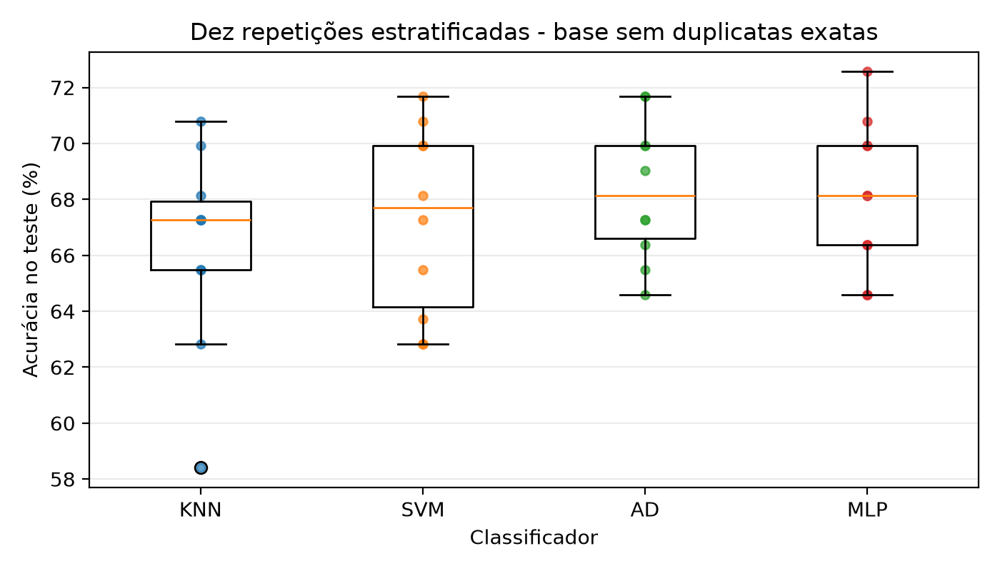

# Comparação de classificadores para risco de saúde materna

Matheus Emanuel Solda de Oliveira, Matheus Buratto, Luiz Otavio, Gabriel Heinrick Dias, Gustavo Nunes

Comparação de classificadores para risco de saúde materna

Matheus Emanuel Solda de Oliveira, Matheus Buratto, Luiz Otavio,

Gabriel Heinrick Dias, Gustavo Nunes

Engenharia de Software - Centro Universitário FAG

Inteligência Artificial - Grupo 2 - 2º Bimestre de 2026

Abstract. We compare KNN, decision tree, SVM and MLP on the UCI Maternal Health Risk dataset. Ten stratified 50/25/25 splits separate training, validation and testing. Exact duplicates are removed and hyperparameters are selected only on validation. AD has the highest observed mean test accuracy (68.32%). Kruskal-Wallis and pairwise Mann-Whitney tests are reported with dependence caveats.

Resumo. Comparamos KNN, árvore de decisão, SVM e MLP na base Maternal Health Risk da UCI. Realizamos dez divisões estratificadas 50/25/25, removemos duplicatas exatas e selecionamos hiperparâmetros somente pela validação. Apresentamos acurácias, dispersão e testes de Kruskal-Wallis e Mann-Whitney. Os resultados descrevem um experimento acadêmico com rótulos conflitantes e escores dependentes.

## 1. Introdução

O objetivo desta avaliação é comparar quatro conceitos de classificação sobre os mesmos dados: vizinhança (KNN), regras hierárquicas (AD), margens de separação (SVM) e redes neurais (MLP). A variável alvo contém três níveis de risco. A métrica principal exigida é a acurácia, fração de predições corretas no conjunto de teste.

A calibração em validação e a avaliação posterior no teste separam a escolha de configurações da estimativa de desempenho. Não desenvolvemos nem validamos uma ferramenta de decisão clínica; o alcance desta análise é a atividade acadêmica.

## 2. Dados e análise exploratória

Ahmed (2020) disponibiliza dados coletados em hospitais, clínicas comunitárias e unidades de saúde materna de áreas rurais de Bangladesh, associados a monitoramento por IoT. A UCI identifica a base pelo id 863 e a distribui sob CC BY 4.0. O arquivo contém 1014 registros e seis atributos numéricos; o portal informa 1.013 registros. Adotamos a contagem verificada no CSV e registramos seu SHA-256.

| Atributo | Significado / unidade | Mínimo / máximo no CSV |

| --- | --- | --- |

| Age | Idade (anos) | 10 / 70 |

| SystolicBP | Pressão sistólica (mmHg) | 70 / 160 |

| DiastolicBP | Pressão diastólica (mmHg) | 49 / 100 |

| BS | Glicemia (mmol/L) | 6 / 19 |

| BodyTemp | Temperatura (°F) | 98 / 103 |

| HeartRate | Frequência cardíaca (bpm) | 7 / 90 |

| Classe RiskLevel | CSV original | Após deduplicação |

| --- | --- | --- |

| low risk | 406 | 234 |

| mid risk | 336 | 106 |

| high risk | 272 | 112 |

Não encontramos ausências. Removemos 562 linhas repetidas considerando os seis atributos e o alvo, restando 452 registros. Essa decisão evita distribuir a mesma linha completa entre conjuntos; também muda a frequência das classes e a população avaliada. Sem identificador de paciente não é possível provar que cada linha representa uma pessoa diferente.

Há 35 vetores de atributos com rótulos distintos. Mantivemos essas observações sem escolher um rótulo por votação. Mesmo sem linhas completas repetidas, vetores de atributos iguais podem aparecer em conjuntos diferentes. As contagens por partição constam em split_audit.json; isso limita a generalização para perfis clínicos ainda não observados.

Registramos os extremos, inclusive HeartRate=7, sem excluir ou corrigir valores por suposição clínica. A regra exploratória de 1,5 intervalo interquartil, aplicada ao CSV original, sinalizou: Age: 1; SystolicBP: 10; DiastolicBP: 0; BS: 210; BodyTemp: 210; HeartRate: 2. Essas contagens não alteram o pré-processamento.

## 3. Protocolo e calibração

Fixamos as sementes 0 a 9 antes da execução. Em cada repetição, embaralhamos a base, separamos 50% para treino e dividimos o restante ao meio, usando estratificação nas duas etapas. Cada divisão contém 226 registros no treino, 113 na validação e 113 no teste. As proporções das classes têm o arredondamento inevitável das contagens inteiras. Os quatro algoritmos recebem os mesmos conjuntos.

Embaralhamos o treino novamente antes dos ajustes. KNN, SVM e MLP utilizam um Pipeline com StandardScaler: calculamos média e escala somente nas 226 linhas do treino. Validação e teste recebem apenas transform. A AD utiliza os atributos originais, pois suas divisões não precisam dessa padronização.

| Modelo | Grade fixa de hiperparâmetros | Candidatos |

| --- | --- | --- |

| KNN | K: 3, 5, 7, 11; pesos: uniform, distance | 8 |

| AD | criterion: gini, entropy; ccp_alpha: 0, 0.005, 0.02 | 6 |

| SVM | C: 0.1, 1, 10; kernel: poly, rbf | 6 |

| MLP | Épocas: 200, 500; taxa: 0.001, 0.01; camadas: (16), (16,8); ativação: identity, logistic, tanh, relu | 32 |

A grade reúne alternativas simples e orçamentos de treinamento executáveis, sem pretensão de busca exaustiva. Na AD, ccp_alpha=0 desativa a poda por complexidade de custo e os valores positivos a habilitam. No SVM, mantemos degree=3 e gamma=scale. No MLP, fixamos solver=adam, early_stopping=False, tol=0 e n_iter_no_change=501 para executar o orçamento de 200 ou 500 épocas; mantemos os demais padrões da versão instalada. Registramos n_iter_ e avisos para cada candidato.

Ajustamos cada candidato somente no treino e escolhemos a maior acurácia de validação. Em empate, usamos a primeira combinação na ordem determinística de ParameterGrid. Retemos o modelo já ajustado, sem novo treino em treino+validação. Somente após a escolha calculamos suas predições no teste. São 520 ajustes de candidatos e 40 avaliações finais. Nenhuma grade foi alterada após observar o teste.

O arquivo candidates.csv registra 320 candidatos com avisos. Atingir o limite de épocas do MLP não garante convergência; com tol=0, o aviso de limite é esperado e não significa, por si só, treinamento inválido. Não aumentamos o orçamento em resposta às acurácias do teste.

## 4. Resultados no teste

| Repetição | KNN | SVM | AD | MLP |

| --- | --- | --- | --- | --- |

| 1 | 62.83 | 62.83 | 66.37 | 66.37 |

| 2 | 65.49 | 65.49 | 67.26 | 64.60 |

| 3 | 58.41 | 63.72 | 64.60 | 64.60 |

| 4 | 70.80 | 68.14 | 65.49 | 72.57 |

| 5 | 67.26 | 69.91 | 69.03 | 69.91 |

| 6 | 65.49 | 62.83 | 69.91 | 66.37 |

| 7 | 67.26 | 71.68 | 71.68 | 68.14 |

| 8 | 69.91 | 67.26 | 71.68 | 69.91 |

| 9 | 67.26 | 69.91 | 69.91 | 68.14 |

| 10 | 68.14 | 70.80 | 67.26 | 70.80 |

| Média | 66.28 | 67.26 | 68.32 | 68.14 |

| DP amostral | 3.58 | 3.36 | 2.50 | 2.67 |

Tabela 1. Acurácias em porcentagem. DP: desvio padrão amostral, com divisor n-1.

Na ordenação descritiva das médias: AD: 68.32% (DP 2.50 p.p.); MLP: 68.14% (DP 2.67 p.p.); SVM: 67.26% (DP 3.36 p.p.); KNN: 66.28% (DP 3.58 p.p.). A maior média observada depende deste protocolo, das grades e da deduplicação.

## 5. Análises estatísticas e comparações individuais

Aplicamos Kruskal-Wallis às quatro amostras de dez acurácias: H=1.76276, p=0.623072. Com alpha=0,05, não rejeitamos a hipótese nula; isso não demonstra equivalência entre os modelos.

Executamos Mann-Whitney bilateral nos seis pares. Usamos a aproximação assintótica, com correção de empates e continuidade da SciPy. Reportamos o p bruto exigido e p ajustado=min(1,6p) por Bonferroni, cujo limiar equivalente é 0,05/6. O teste compara distribuições; diferenças de média servem aqui como descrição de direção.

| Par | U | p bruto | p Bonf. | Sig. Bonf. |

| --- | --- | --- | --- | --- |

| KNN x SVM | 42.5 | 0.59335 | 1.00000 | Não |

| KNN x AD | 35.0 | 0.26776 | 1.00000 | Não |

| KNN x MLP | 36.5 | 0.32282 | 1.00000 | Não |

| SVM x AD | 41.5 | 0.54230 | 1.00000 | Não |

| SVM x MLP | 42.5 | 0.59419 | 1.00000 | Não |

| AD x MLP | 52.0 | 0.90900 | 1.00000 | Não |

KNN x SVM: SVM teve média 0.97 pontos percentuais maior; não há diferença significativa no teste bruto ou ajustado. A interpretação é exploratória.

KNN x AD: AD teve média 2.04 pontos percentuais maior; não há diferença significativa no teste bruto ou ajustado. A interpretação é exploratória.

KNN x MLP: MLP teve média 1.86 pontos percentuais maior; não há diferença significativa no teste bruto ou ajustado. A interpretação é exploratória.

SVM x AD: AD teve média 1.06 pontos percentuais maior; não há diferença significativa no teste bruto ou ajustado. A interpretação é exploratória.

SVM x MLP: MLP teve média 0.88 pontos percentuais maior; não há diferença significativa no teste bruto ou ajustado. A interpretação é exploratória.

AD x MLP: AD teve média 0.18 pontos percentuais maior; não há diferença significativa no teste bruto ou ajustado. A interpretação é exploratória.

O enunciado exige testes concebidos para amostras independentes. Aqui os modelos compartilham partições e as repetições reutilizam registros da mesma base. Logo, não atendemos estritamente à independência; os valores de p não sustentam uma afirmação confirmatória de superioridade. Um estudo posterior deve planejar inferência pareada e controlar a dependência de reamostragem. Bonferroni não corrige essa dependência.

## 6. Conclusões e reprodução

AD apresentou a maior média de teste neste experimento. O protocolo cumpriu as dez repetições, as partições estratificadas 50/25/25, a calibração na validação e a avaliação final separada. Os resultados não estabelecem um algoritmo universalmente melhor e não estimam desempenho clínico fora desta base.

As principais limitações são a amostra reduzida após deduplicação, a ausência de identificador de paciente, os vetores com rótulos conflitantes, a retenção de extremos, as grades finitas e a dependência dos escores nos testes exigidos. Acurácia também pode ocultar diferenças por classe; salvamos matrizes de confusão e precision, recall e F1 por classe como material complementar, sem utilizá-los na seleção.

Na semente 0, as configurações escolhidas foram:

| Modelo | Hiperparâmetros escolhidos |

| --- | --- |

| KNN | {"n_neighbors": 11, "weights": "uniform"} |

| SVM | {"C": 1.0, "kernel": "rbf"} |

| AD | {"ccp_alpha": 0.02, "criterion": "gini"} |

| MLP | {"activation": "relu", "hidden_layer_sizes": [16], "learning_rate_init": 0.001, "max_iter": 500} |

O arquivo best_params.csv contém as 40 escolhas; candidates.csv contém os 520 candidatos e suas acurácias de validação. splits.csv preserva os índices originais e predictions.csv permite recalcular cada acurácia. O experimento utiliza uma thread numérica e Python 3.14.6; versões: numpy 2.5.5; pandas 3.1.1; scipy 1.18.1; scikit-learn 1.9.1; matplotlib 3.11.2; threadpoolctl 3.8.0.

Para reproduzir, instale requirements.txt em ambiente virtual e execute python -m src.experiment --output results-reproducao. Para regenerar este documento a partir dos resultados oficiais locais, execute python scripts/build_report.py. O README descreve a instalação, os testes e o empacotamento.

## Referências

Ahmed, M. (2020). Maternal Health Risk [Dataset]. UCI Machine Learning Repository. https://doi.org/10.24432/C5DP5D. CC BY 4.0. Acesso: 26 nov. 2026.

Scikit-learn. Common pitfalls and recommended practices; MLPClassifier; User Guide. https://scikit-learn.org/stable/. Acesso: 26 nov. 2026.

SciPy. kruskal e mannwhitneyu, documentação da API. https://docs.scipy.org/doc/scipy/reference/stats.html. Acesso: 26 nov. 2026.

SBC. Modelo de artigos, reproduzido em material da UFPR: https://www.inf.ufpr.br/menotti/ci1027-261/slides/t01-latexoverleaf.pdf. A4, coluna única, Times 12, margens superior 3,5 cm, inferior 2,5 cm e laterais 3 cm. Sem marcação chapter. O link atual da SBC estava indisponível na consulta.
